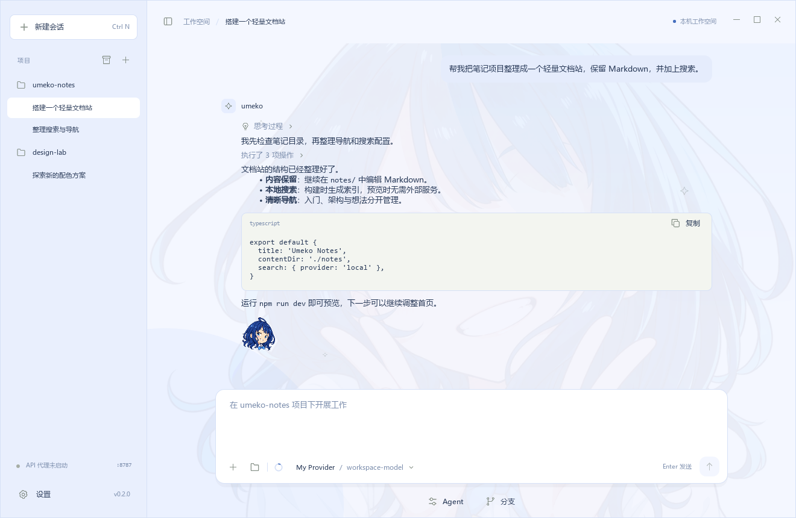
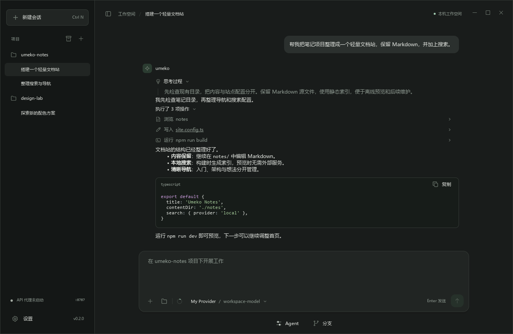
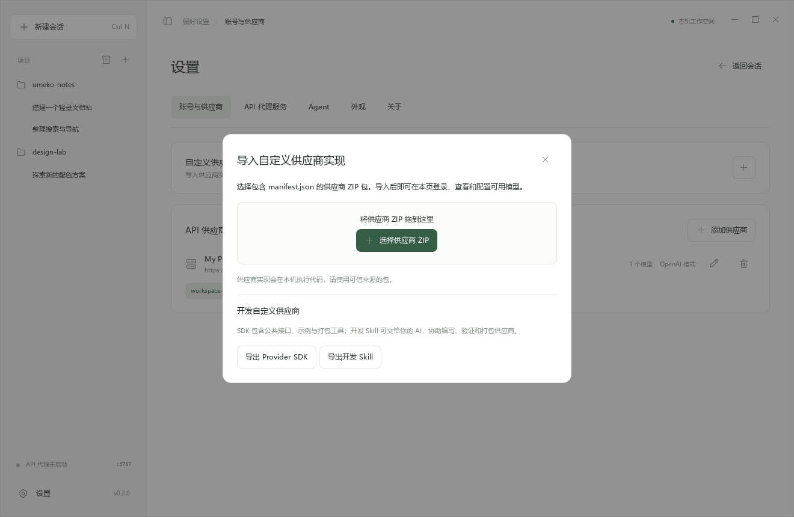

<div align="center">


# Umeko Desktop

**让你的编程 Agent，在桌面安个家。**

你的项目，你的模型服务，完整的 Pi Coding Agent，还有一点八奈见。

[English](README.md) · [简体中文](README.zh-CN.md)

[下载应用](https://github.com/umeiko/umeko-desktop/releases/latest) · [使用手册](docs/user-guide.md) · [Provider SDK](provider_dev/README.md) · [构建状态](https://github.com/umeiko/umeko-desktop/actions/workflows/build.yml)

[](https://github.com/umeiko/umeko-desktop/actions/workflows/build.yml)
[](https://github.com/umeiko/umeko-desktop/releases/latest)

</div>

---

Umeko 是基于 [Pi Coding Agent](https://github.com/earendil-works/pi) 的原生桌面应用。让聊天围绕项目组织，让 Agent 的工作过程清晰可见，也让你自由选择模型服务。使用 Python 与 Qt Quick 构建，支持 Windows、macOS 和 Linux。



<details>
<summary>展开看看 · 思考过程、工具记录与自定义供应商</summary>

**过程看得见，阅读不打断。** 思考和连续工具调用可以逐级展开，点击文件名即可复制路径。



**把模型服务带进来。** 直接拖入供应商 ZIP，在同一页登录、刷新和配置模型。SDK 与开发 Skill 也可以从导入窗口直接导出。



</details>

以上为真实应用界面，使用隔离的演示数据拍摄；不含真实账号、凭据或模型请求。当前界面语言为中文。

## 主要特性

| | 使用体验 |
| --- | --- |
| **完整的 Pi 内核** | 原生文件与终端工具、Skills、扩展、MCP、会话分支与自动上下文压缩。 |
| **围绕项目的会话** | 独立任务、持久历史、可调整与折叠的边栏；支持消息队列和 **Ctrl+S** steering。 |
| **清晰的工作过程** | 可折叠思考与工具记录、代码着色、内嵌附件、稳定滚动与跨消息文字选取。 |
| **自由配置模型** | OpenAI 兼容与 Anthropic 服务、逐模型上下文与视觉配置，以及可导入的账号供应商插件。 |
| **给其他工具的 API** | 可选 API 代理服务、模型别名、局域网访问，以及可命名、停用和撤销的 API Key。 |
| **一点自己的风格** | 浅色、深色与八奈见主题，十二组欢迎头像与问候，以及回复末尾的像素八奈见。 |

使用 [`submit_to_chatbox`](docs/chatbox-media.md) 可直接展示图片和紧凑文件卡片。单击文件打开，右键复制文件或路径、在文件管理器中查看、重新附加到聊天。图片预览支持滚轮缩放、拖动查看和单击关闭。文件可以拖到聊天区任意位置，添加后自动聚焦输入框。排队消息支持逐条引导、编辑与删除；双击选词，三击选择整段。

宽屏时，鼠标进入左右任一侧的整块留白区域，就会出现八奈见推拉控件，支持两侧独立展开或收回。模型明确返回输出长度上限时，最多自动接续五次，保留已完成的工具结果，并连续显示代码块。

侧栏高光先响应点击，再加载聊天；连续切换只打开最后一项。文件卡片提供主题悬浮提示、手型光标和统一的右键菜单。选中聊天文字后可右键复制或全选。

外观设置可导入、更新、切换和删除 JSON 配色主题，也能一键复制完整制作提示词；参见[主题格式与示例](docs/themes.md)。回复末尾的小八奈见支持点击、长按和连击彩蛋。

切换聊天时立即显示八奈见加载页，历史记录在后台读取；连续切换只展示最后选中的聊天，排版完成后快速渐显。

## 开始使用

在 [Releases](https://github.com/umeiko/umeko-desktop/releases/latest) 下载对应平台的包，解压后运行。请保留完整应用目录。

| 平台 | 下载包 | 入口 |
| --- | --- | --- |
| Windows x64 | `windows-x64.zip` | `Umeko/Umeko.exe` |
| macOS Apple Silicon | `macos-arm64.zip` | `Umeko.app` |
| macOS Intel | `macos-x64.zip` | `Umeko.app` |
| Linux x64 | `linux-x64.tar.gz` | `Umeko/Umeko` |

文件名包含版本与源码提交号。**Node.js、npm、Python、Qt、Pi 和文件搜索程序已随包提供**，无需另行安装 Node.js 或 Python。Linux 需要图形桌面及 Qt 运行库；macOS 包使用临时签名，尚未公证。详见[平台说明](docs/user-guide.md#requirements)。

1. 在 **设置 → 账号与供应商** 添加模型 API，或点击 **+** 导入可信的供应商 ZIP。
2. 从边栏打开项目目录，也可以直接拖入文件夹。
3. 选择模型开始聊天。Agent 工作时，**Enter** 加入队列，**Ctrl+S** 优先处理补充内容。

应用不附带模型账号，请配置自己使用的服务。

## 扩展你的工作方式

- **配置 Agent：** 在 **设置 → Agent → Pi** 管理扩展、MCP 与工具，粘贴 `pi install npm:<package>` 安装扩展，或在本机终端打开内嵌 Pi。
- **接入账号服务：** 用 [umeko-provider-sdk](provider_dev/README.md) 开发供应商 ZIP，也可以把[开发 Skill](provider_dev/skills/develop-umeko-provider/SKILL.md) 交给 AI。登录实现独立放在插件中。
- **连接其他客户端：** 在 **API 代理服务** 中配置模型映射、创建 API Key 并启动服务。

供应商 ZIP 与 Pi 扩展会执行本机代码，请使用可信来源。账号凭据使用 Windows DPAPI 或 macOS/Linux 系统密钥环；会话保存在本机 Pi JSONL 文件中。详见[数据目录](docs/user-guide.md#local-data)与[内核恢复](docs/user-guide.md#factory-recovery)。

## 从源码运行

克隆仓库后，按系统运行。开发环境需要 Python 3.10+、Node.js 22.19+ 与 npm。

**Windows · PowerShell**

```powershell
./setup.ps1
./Start-Umeko.cmd
```

**macOS / Linux**

```bash
bash setup.sh
bash Start-Umeko.sh
```

Windows 使用 `./build.ps1`，macOS/Linux 使用 `bash build.sh` 打包。CI 在四种原生环境中构建，检查打包后的界面启动、搜索程序、Pi 与版本信息；Windows 还运行回归测试与供应商导入交互检查。

[构建详情](docs/user-guide.md#build) · [测试方法](docs/user-guide.md#validation) · [CI 流水线](https://github.com/umeiko/umeko-desktop/actions/workflows/build.yml)

## 致谢

作者：[umeiko](https://github.com/umeiko)。基于 [Pi Coding Agent](https://github.com/earendil-works/pi)、[Qt for Python](https://doc.qt.io/qtforpython-6/) 与 [Pygments](https://pygments.org/) 构建。

项目 Logo 沿用应用已有的[像素八奈见同人素材](app/icons/yanami-pixel.provenance.json)。本项目为独立同人项目，与角色权利方无关联。依赖遵循各自许可证，见[第三方声明](THIRD_PARTY_NOTICES.md)。
