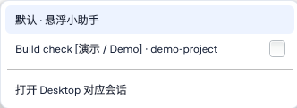

# 桌宠命令入口：维护者主线上的独立功能补丁

## 最新复验：main `100c7226` / #184 多行输入整合（2026-11-19）

本节取代下方历史基线的当前验收口径。保留维护者共享 ChatInput / ScrollView、多行输入和 IME 处理，并恢复项目目标、定时分步问答、草稿与 Escape 返回。功能代码与已验收验证目录完全一致；未加入路径别名修复或 #152 智能体选择。

- 87 项项目、定时、文本解析、助手和桌宠单元测试通过。
- 独立 Pi 1.5.2 运行时与当前源码桥自检通过。使用本地合成模型服务和真实 Pi 子进程：桌宠任务工具往返、项目 prompt / follow-up、定时确认、草稿隔离、拖动、原桌宠 UI 均通过；另通过 3 项取消测试及 task-state UI 测试。
- Qt-only 合并冒烟覆盖多行输入、合成 IME、焦点、项目路由与 Esc 草稿恢复。此项使用模拟路由，不冒充端到端测试。
- 以下为 Linux Qt offscreen 原生窗口抓图或按窗口坐标合成图，仅含合成测试数据，不是 Windows 桌面截图。没有验证 Windows 原生 IME、多屏、安装包、完整 Bash 子进程树清理或全量测试。
- 运行时从现有本地精确版本依赖恢复，并非成功完成全新依赖安装；此前镜像返回拦截 HTML 引起的 SRI 安装问题仍是复现边界。保留 offscreen 窗口 mask/raise 与退出警告，不据此声称实体桌面验收。

## 与 main `5966b52` 整合

保留上游的凹槽输入、Desktop 与发送按钮、IME、拖动和紧急通知避让。项目标签在输入槽内占用独立空间。项目菜单、定时问答和修改菜单保持胶囊焦点域；定时任务仍通过现有 scheduled-tasks 服务并须明确确认。

已通过 131 项 Python 测试、Pi 1.5.2 自检和五项 Linux Qt 离屏冒烟（桌宠、胶囊任务、拖动、IME 几何、项目与定时问答）。覆盖合成 IME 事件、通知避让、草稿与附件隔离、原地问答及重复确认只创建一条任务。使用隔离配置、中英文演示数据和本地模型夹具。离屏环境保留平台窗口与 Qt 退出警告。未验证 Windows 实机输入法、实体桌面、多屏及安装包。

## 此前在 main `783057c` 上的验收

基线：`783057c`（包含已合并 #166、#157）；分支：`feat/153-pet-timer-entry`。
关联 #151、#153；不是两个 Issue 的完整实现，不使用 `Closes`。

## 已实现

- 双击维护者胶囊，显式提交 `/定时任务 正文`，在桌宠旁逐项询问缺少的必填内容，使用原胶囊输入回答，不打开 Desktop 表单。已提供的指令自动跳过；选择、修改与最终确认都在桌宠中完成。胶囊原文保留。
- 默认需显式选择已有、持久化的普通通用/项目会话；胶囊已选择项目时沿用该归属。全局助手、临时会话、归档/已删除项目不作为归属；没有归属时原地解释缺少已有会话，不跳转、不创建替代会话。
- 名称、指令、执行对象、计划参数由既有 Schedule 校验；仅单次日期时间与固定间隔，仅提取无歧义的明确字段与受支持短语，不把每天固定时间变成 24 小时间隔。确认卡显示真实归属、执行对象、时间及时区和运行要求。
- 明确确认后调用既有 `scheduled-tasks.save`，复用权限、目标白名单、数量上限与调度引擎。创建成功显示“等待触发（不是执行完成）”。
- 会话独立草稿；已恢复旧草稿时明确说明新输入仍在胶囊。发送前持久化“不确定结果”标记，重复确认与重启不自动重试。失败/未知结果后禁止重试；用户自行核对任务列表后，可在卡片明确选择“已核对未创建”来重新准备。未提交的当前回答也按归属与步骤保存，Esc/关闭后可恢复。
- `/项目 正文` 在胶囊旁打开紧凑已有项目会话菜单；选中后胶囊内显示可辨识目标按钮，正文直接在胶囊输入并发送。不打开 Desktop 项目模态窗口。空闲时调用 `_command_pi("prompt", record=...)`；忙碌、已就绪时调用显式 record 的原生 `follow-up` 队列。主窗口选择和双方草稿/附件不变。运行详情、队列编辑/取消与审批仍由 Desktop 处理。
- 项目发送前持久化恢复记录；默认不自动重试、不自动重放。原生队列回执和输入回执更新状态。收到原生肯定回执后可显式发送不同的新正文；结果不确定或正文重复时，需先核对旧记录并明确解除保护。加载、审批、检查点恢复、受管理任务尝试或并发已满时拒绝并保留正文。

## 明确的取舍 / 尚未实现

- 项目入口只选择已有持久化项目会话，不自动建立会话。也可单独输入 `/项目`，选中目标后直接在胶囊补充正文。目标按钮可切换已有项目会话或返回默认助手，各目标保留独立正文；目标已有草稿时拒绝覆盖并保留来源正文。切回默认时清除活动项目身份但保留 drafts，覆盖“项目 A → 默认 → /项目 新正文 → A”冲突和无正文恢复路径；提交标记落盘失败时保留正文且不发送。项目功能不调用依赖 `_view` 的 `_send`，也不新建私有自动派发队列。原生 follow-up 已提交后的执行、撤回、关闭恢复遵循现有内核契约；本地恢复记录不会自动重放。
- 默认胶囊仍发送给维护者绑定的全局助手，不改成普通通用会话；不修改绑定、人设、通知、送达回执、限流、双击、普通发送或动画。
- 不改胶囊颜色、尺寸、边框和图标；功能与外观补丁独立。此分支只增添命令路由、功能必需的目标按钮与紧凑菜单，不调整胶囊边框、配色、尺寸或发送箭头。
- 不实现完整斜杠目录、拼音搜索、所有 Widget/Skill 动作，也不新增提醒入口、任意自然语言调度或新调度语义。已有提醒功能不变。
- 未提交的项目/默认助手正文在当前进程内隔离保留，未新增其跨重启恢复承诺；已提交项目恢复记录和定时分步草稿持久化。
- 磁盘完全不可写时无法保证退出后的草稿持久化；无法保存创建前标记时拒绝创建并明确告警。
- 没有 Windows 实机；Linux offscreen 不足以验证 Windows 原生 IME、焦点、窗口遮罩与多屏行为。

## 验证

- 独立复制 Pi 1.3.0 运行时，执行 `verify_runtime` 同步当前源码适配器并通过自检；不修改或共享旧 bridge。
- Python：141 项通过。`test_pet_timer`、`test_pet_project`、`test_pet_assistant`、`test_desktop_pet`、`test_pet_reminders`、`test_scheduled_task_host`、`test_scheduled_tasks`、`test_scheduled_task_plugin`。
- Node：`node --test tests/global-agents.test.mjs`，6 项通过。
- 未修改的 `desktop_pet_task_ui_smoke.py`：双击、绑定、普通发送、IME、取消、焦点、屏幕边缘、字体缩放、PID 与真实本地 Pi 工具链往返通过（模型服务为本地 fixture）。
- 未修改的 `desktop_pet_ui_smoke.py`：原桌宠菜单、动画、提醒与通知 UI 回归通过。
- `pet_timer_ui_smoke.py`：真实胶囊 -> 桌宠分步卡片 -> 既有 Widget worker，确认前不创建，连续确认只创建一项；主窗口草稿和默认绑定不变。项目菜单 Esc、键盘选择、默认/项目切换、同目标消费命令而保留正文通过；真实 Pi prompt 与 follow-up 两轮通过，实际 transcript 含两条指令且不含目标原有附件；主窗口及目标草稿/附件保留。模型服务使用本地 fixture，未调用远程模型。
- 预览使用隔离临时配置和普通持久会话 fixture；定时创建是真的本地 Widget 调用，没有远程模型调用，也没有等待 2035 年的任务执行。
- offscreen 报告不支持 raise/window masks，并在引擎销毁时有既有异步组件提示；不将其作为 Windows 验收证据。新卡片无 ReferenceError/TypeError。

截图在 `build/pet-timer-ui/`：`01-no-owner.png`、`02-missing-fields.png`、`03-confirm.png`、`04-created.png`、`05-restored-draft.png`、`06-project-menu.png`、`07-project-capsule.png`。历史大表单截图已过期，不作为当前设计。

此修订更新功能 PR #158，不涉及发布或合并。

## 桌宠内分步创建修订

- 支持初始输入中标注的“名称/指令/日期/时间/时区”，明确绝对日期时间（如 `2035-1-2 9:30 检查构建`）以及 `每隔 10 分钟检查构建`；可靠识别的字段自动跳过。
- `每天 9 点检查构建` 识别 09:00 和正文，但当前创建 API 不支持日历循环，因此明确告知并要求用户选择新计划，不转换成每隔 24 小时。相对日期暂不猜测，原地追问明确日期。
- 冲突字段留空重新确认，未标注尾句保留在指令中；旧草稿不被新提取内容覆盖。不支持的复合时长保留原文并追问，不截断为不同的有效计划。
- 原生鼠标点击选项/确认、Escape 退出、未提交回答恢复、跨窗口输入焦点均已在 Linux offscreen 测试。原生项目测试使用独立 `agentDir`，不依赖用户家目录。
- `08-question-layout-preview.png` 与 `09-confirm-layout-preview.png` 是生产窗口类型的实际 Qt 离屏抓图，按窗口实际全局坐标合成于中性背景；未修改 Popup/Tool 类型。不是 Windows 实机截图。

- 带 UTC 偏移、Z、AM/PM、时区后缀、范围或选择修饰的时间不会消费合法前缀，会原文保留并要求明确填写。频率步骤中的额外正文/限制不会被忽略，该回答整体拒绝且保留输入，提示单独补充执行指令。

## 与已合并 #166 / #157 整合（2026-11-16）

- 合入 main `783057c`，保留维护者已接收的非模态 Tool 输入栏、全局坐标拖动、普通气泡隐藏、重要通知避让、IME commit/reset/query 更新，以及蓝边/蓝箭头/Desktop 入口。
- 定时问答卡改为同族非模态 Tool 窗口：原 Popup.Window 在实际 Qt 测试中截走输入栏 Escape，因此不是仅机械解决冲突。卡片、修改菜单、项目菜单纳入 150ms 失焦检查范围；选择后重新激活输入窗口。退出问答保留未提交回答与原命令。
- 辅助卡片/菜单按当前屏幕可用区域翻转，并避开输入栏和重要通知；空间不足时关闭输入栏但保留草稿，不覆盖通知。更换默认助手绑定时清除旧项目模式。
- 本次验证：141 项 Python 测试通过（84 pet、22 desktop_pet、35 scheduled）；6 项 global-agents Node 测试通过。Qt/Pi `pet_timer_ui_smoke`、`desktop_pet_task_ui_smoke`、`desktop_pet_drag_ui_smoke`、`desktop_pet_ui_smoke` 均通过；额外覆盖问答卡/修改菜单/项目选择后停留 350ms、Escape 与草稿恢复。截图由本次隔离 Qt 运行重新生成。
- 仍需维护者在 Windows 验证真实中文输入法候选窗、切换外部应用、DPI/多屏；Linux offscreen 只验证 Qt 逻辑和窗口抓图，不声称完成 Windows 验收。
