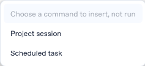

# #151 桌宠命令菜单：双语验收

基线：PR #158 的 `ff5ed9e`。本次只增量提供已有项目和定时任务的菜单入口，不是 #151 的完整实现。

- 打开桌宠胶囊，点击 `/`。菜单标题、入口、禁用原因、动态错误和按钮无障碍名称均随界面语言显示。
- 选择入口只把命令写入草稿，不执行、不发送，也不改变主窗口会话或草稿。英语显示 Project session / Scheduled task，但插入的仍是现有解析器接受的 `/项目` 和 `/定时任务`，没有新增英语别名。
- Esc 关闭菜单并保留草稿；禁用定时任务 Widget 后，该入口灰显并说明原因；过期菜单不会改写草稿。未知斜杠文本或路径保留原样。

运行时 Pi 1.5.2 自检通过；62 项聚焦测试、静态翻译词典回归、中文与英文菜单及原定时任务 Qt 冒烟通过。下图为隔离配置、合成数据下的 Linux Qt 离屏弹出窗口原始截图。未验证 Windows 实机、原生输入法、多屏或安装包；离屏平台仍有窗口 mask 与 Qt 退出提示。

| 状态 | 中文 | English |
| --- | --- | --- |
| 可用 |  |  |
| 定时任务 Widget 禁用 |  |  |
