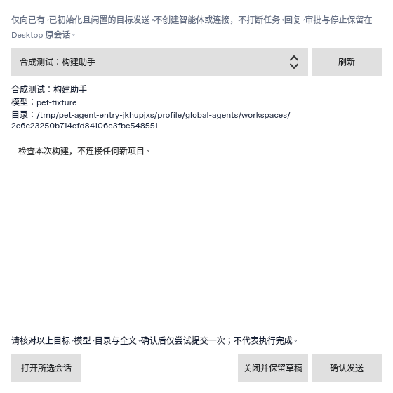
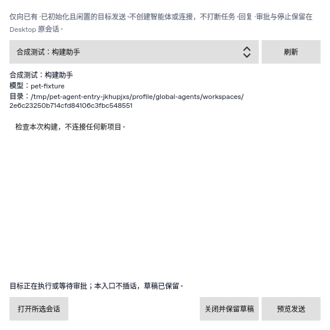
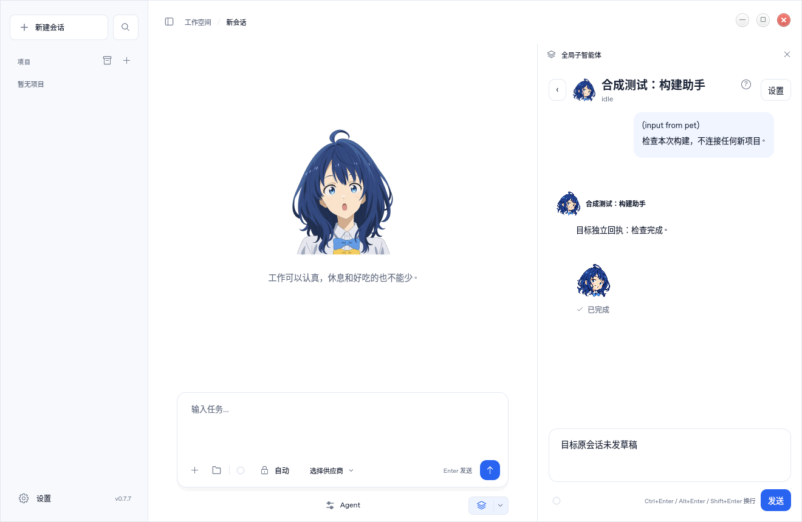

# Explicit existing-agent handoff: first milestone of #152

Base: main `fccee3a428746dde96c08122ffdf00ca9e6551da`.

The pet context menu opens a separate, explicit handoff window. It lists only existing targets; an initialized, idle non-default agent is required. Review the target, model, workspace and text before confirming. Busy agents, pending approvals, target/configuration replacement and disabled service reject without fallback or interruption. Uncertain/failed dispatch preserves the draft and does not retry automatically. Replies, approvals and stop remain in the exact existing Global Agents conversation; the window links there and never rebinds the pet companion. Drafts are process-local, not restart persistence.

This is **part of #152**, not completion of `/全局智能体`, `/委派任务`, creation, scheduling or arbitrary task routing. No new project grants, connections or model-facing API.

## Actual Linux Qt previews with synthetic data

## Verification

- 150 Python test executions passed across target/entry, companion, desktop pet, global agents and reminders (entry fixture inherits target cases).
- Real Qt + native Pi 1.5.2 with local completion fixture: actual target selector, Enter newline, IME preedit disables confirmation, Escape retains draft; busy, approval, removed target and failed dispatch rejection; single native prompt, persisted reply and accurate original-conversation navigation; main draft/attachments, target composer draft and companion binding/speech isolation.
- Existing pet input and global-coordinate drag smokes passed.
- Exact source bridge prepared and self-tested with `python prepare_runtime.py`.
- Separate disposable combination with #158 `ff5ed9e9615d454cc445a92bbcafd594d7112988` plus current main passed 94 target/project/timer test executions, this entry smoke, and existing `pet_timer_ui_smoke.py` including real project prompt/follow-up and one-shot timer confirmation. Preserve all three independently initialized entries when merging the adjacent `DesktopPet.__init__` additions.

Offscreen Linux Python/PySide only. No Windows/macOS native IME, external focus, multi-monitor DPI, C++ build or installer claim. Existing offscreen raise/mask and teardown incubation warnings remain. No remote CI claimed for this unpublished candidate.
