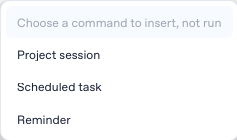
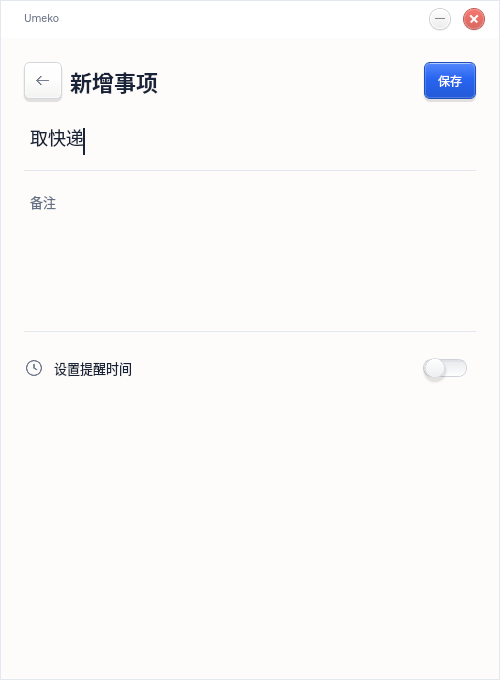
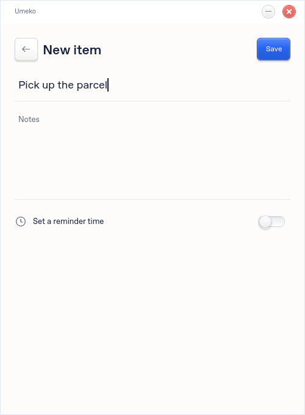

# #153 桌宠提醒入口验收

基线：PR #158 `c402a5e7`。此增量只接入既有的本地提醒表单，不改定时任务或时区引擎。

1. 打开桌宠胶囊并点击 `/`。选择「/提醒」或英语「Reminder」仅为草稿加上 `/提醒`，不会打开窗口或创建事项。
2. 明确发送这条命令后打开现有「新增事项」窗口。短单行正文预填标题，长文或多行预填备注，不推断时间。未设置提醒时间时，保存的是普通待办。
3. 在窗口点「保存」才创建事项，返回或关闭不创建。桌宠原文及项目目标保留；已有打开的提醒草稿不会被覆盖。过期绑定、失效项目或超过 2000 个 UTF-16 代码单元的正文不会打开新表单。
4. 本地提醒入口不调用模型。表单预填仅通过一次性的 UI 交接，不进入公开状态或模型上下文。

以下为隔离配置、合成数据的 Linux Qt 离屏实抓，非 Windows 实机。两种语言均验证了选择仅准备、明确提交后只打开表单、取消不创建、明确保存仅创建一次以及草稿隔离；模型派发和 Agent Widget 调用均断言没有发生。未测实体桌面、Windows 原生输入法、多屏或安装包。

| 状态 | 中文 | English |
| --- | --- | --- |
| 命令菜单 |  |  |
| 提交后、保存前 |  |  |

## 回归结果与边界

147 项 Python 测试通过（113 项桌宠、命令、定时、设置与字典回归，34 项提醒后端测试）；Pi 1.5.2 自检及原命令菜单 Qt 冒烟通过。原定时任务 Qt 冒烟在此离屏环境不稳定：使用相同运行时交替重跑，未改基线 1/2 通过、此候选 0/2 通过（另有一次未启用 faulthandler 的初次候选失败）。已记录的崩溃均位于原测试的时序相关 QML 调用 `pet_timer_ui_smoke.py:79`，在进入任何新提醒路径前；没有定位根因，也不声称完整 Qt 回归通过。

上述失败是旧冒烟定位方式的历史数据。最终候选只改了该测试的查找方式：等待目标会话的可见原生列表项，使用其实际坐标点击；保留原有会话归属、确认和只创建一次的断言。改后原定时任务 Qt 冒烟连续 3/3 通过，中英文提醒与原命令菜单均重跑通过。没有修改定时产品行为；这也不是原生窗口崩溃根因已解决的证明。
