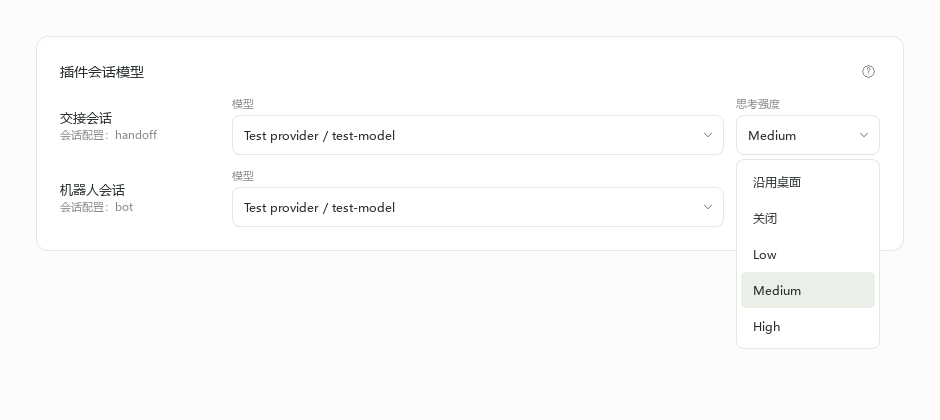
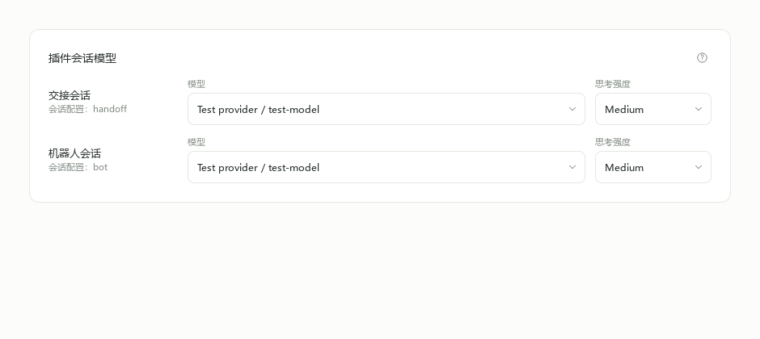

# Python 桌面设置与 Agent 操作

Python 版把设置页中的日常配置接到统一桌面操作上。Agent 可以读取当前设置，再修改明确列出的字段；界面和 Agent 共用现有设置控制器。插件会话的模型与思考强度可在运行中调整，权限配置继续由用户批准。

插件会话思考档位的后端基础由 [#163](https://github.com/umeiko/umeko-desktop/pull/163) 提供。本次改动在该接口上增加设置页思考下拉框、恢复继承的 `inherit` 操作值和其余设置操作，沿用其配置继承、保存回滚和输入边界更新方式。

先调用 `operations.list` 获取当前应用提供的操作，再调用 `settings.get` 读取配置。操作使用 `{"operation":"操作名","arguments":{...}}` 格式。下表按已有能力、本次新增或扩展、保留用户确认或内部状态列出设置，包含设置页以外持久保存的相关偏好。

配置中的模型示例统一使用 `test-model`，供应商示例使用 `Test provider`；使用时填写本机已经配置的桌面模型别名与供应商 ID。

## 已有操作

表中 `settings.json` 指当前应用 profile 的文件。应用先采用显式目录或 `UMEKO_DATA_DIR`，再采用平台数据目录；具体规则见 [Store](../app/storage.py)。账号密钥通过现有凭据保护保存，读取设置返回配置和密钥是否存在的状态。

| 设置 | 保存位置 | 已有操作与主要参数 | 保存与生效时机 | 源码入口 |
| --- | --- | --- | --- | --- |
| 语言 `ui.language` | `settings.json` | `appearance.language {language:zh或en}` | 界面更新；Pi 在重载时采用新语言 | [PreferencesMixin.setLanguage](../app/preferences.py) |
| 字体 `fontFamily` | 同上 | `appearance.fonts` 查询；`appearance.fontFamily {family}` 选择 | 保存后立即应用字体 | [Controller.setFontFamily](../app/controller.py) |
| 侧栏宽度与折叠 `ui.sidebarWidth/sidebarCollapsed` | 同上 | `appearance.sidebar {width,collapsed}`；宽度 200–480 | 保存后立即调整侧栏 | [Controller.saveSidebarLayout](../app/controller.py) |
| 主题 `theme/dark/themes` | 同上 | `themes.select {id}`、`themes.import {path}`、`themes.remove {id}` | 保存后立即应用；`dark` 随所选主题更新 | [Controller.setTheme/importTheme/removeTheme](../app/controller.py) |
| 角色选择 `character` | 同上；导入的角色包由角色库保存 | `characters.select {id}`、`characters.import {path}`、`characters.remove {id}` | 保存后切换角色 | [CharactersMixin.selectCharacter](../app/characters.py) |
| 角色对话、动作与子 Agent 配置 | `character-config.json` | `characters.configure {config}`；`characters.config` 读取 | 保存配置后应用角色选项 | [CharactersMixin.configureCharacter](../app/characters.py) |
| 回答上限、自定义指令、自动压缩 `agent.maxTokens/instructions/autoCompaction` | `settings.json` | `agent.save {config:{...}}`；上限 256–32768，自定义指令最多 16000 字符 | 保存后重载 Pi；忙碌会话在任务结束后应用。压缩时机由 Pi 原生设置决定 | [Controller.saveAgent](../app/controller.py)、[AgentSettings](../app/qml/AgentSettings.qml) |
| 资源目录和附加路径 `agent.agentDir/skillPaths/extensionPaths` | 同上 | `agent.save {config:{...}}`；路径字符串与数组 | 转为本机绝对路径后保存，重载相关 Pi 会话 | [Controller.saveAgent](../app/controller.py) |
| 恢复模式 `agent.safeMode`、重新加载与恢复内核 | 同上；恢复操作生成备份与新资源目录 | `agent.recovery {enabled}`、`agent.refresh`、`agent.restoreFactory` | 恢复模式保存后重载；恢复内核按现有备份流程执行，由用户要求触发 | [PiManagement.setRecoveryMode/restoreFactory](../app/pi_management.py) |
| npm 网络覆盖 `agent.npmRegistry/npmUserconfig/npmCafile` | `settings.json` | `network.npm {config:{...}}`；空字符串清除该覆盖；`network.testNpm` | 保存后供后续 npm 子进程使用；连接检查结果在状态中显示 | [PiManagement.saveNpmConfig](../app/pi_management.py) |
| 自动打开提交结果、网页展示、聊天宽度提示 `desktop.autoOpenSubmissions/webDisplay/chatWidthHints` | 同上 | `desktop.configure {config:{...}}`；局部修改；网页模式为 embedded/external | 保存后热更新已有 Pi 进程；启动时跳过 WebView 加载的外部模式切回内置预览时，按提示重启应用 | [PreferencesMixin.saveDesktopSettings](../app/preferences.py)、[desktop_preferences](../app/desktop_preferences.py) |
| 生成图片配置 `multimodal.image` | 同上 | `generation.configure {config:{image:{providerId,model,size,quality,count,format}}}`；数量 1–10，格式空/png/jpeg/webp | 模型空闲时保存并重载 Pi，后续生成采用新值 | [multimodal_settings.validate](../app/multimodal_settings.py)、[PreferencesMixin.saveMultimodalSettings](../app/preferences.py) |
| 生成语音配置 `multimodal.speech` | 同上 | `generation.configure {config:{speech:{providerId,model,voice,format,speed}}}`；语速 0.25–4，格式 mp3/opus/aac/flac/wav/pcm | 同上 | 同上 |
| 生成视频配置 `multimodal.video` | 同上 | `generation.configure {config:{video:{providerId,model,seconds,size}}}`；时长为正整数字符串，尺寸为 WIDTHxHEIGHT | 同上 | 同上 |
| 辅助视觉 `auxiliaryVision.providerId/model/autoAnalyze/toolEnabled` | 同上 | `vision.configure {config:{...}}`；选择已配置且支持图片的模型 | 保存后重载 Pi | [AuxiliaryVisionMixin.saveAuxiliaryVision](../app/auxiliary_vision.py) |
| Provider 名称、协议、地址、密钥与模型 `providers` | 同上；密钥采用本机凭据保护 | `providers.save {id,name,api,baseUrl,key,models}`、`providers.addCommon`、`providers.remove` | 相关 Provider 空闲时保存并重载 Pi | [Controller.saveProvider/removeProvider](../app/controller.py)、[Store._serialize](../app/storage.py) |
| Provider 代理与证书 `providers[].proxy.mode/url/caFile` | 同上 | `providers.network {id,mode,address}`；mode 为 system/direct/custom；`providers.certificate {id,caFile}` | 相关 Provider 空闲时保存，后续请求采用新配置 | [PreferencesMixin.setProviderNetwork](../app/preferences.py) |
| 每模型别名、上下文窗口、视觉能力、自动/手动思考级别和格式 `providers[].models` | 同上 | `models.mappings {models:[...]}`；包含 contextWindow/Auto、vision/Auto、reasoningLevels/Auto、reasoningFormat/Auto 等现有模型字段 | 模型空闲时保存并重载；自动能力探测使用现有流程 | [Controller.saveMappings/_validate_model_mappings](../app/controller.py)、[normalize_model](../app/model_capabilities.py) |
| API 代理端口、协议与局域网 `server.port/openai/anthropic/lan` | 同上 | `server.save {port,openai,anthropic,lan}`、`server.toggle`；端口 1024–65535，至少启用一种协议 | 保存后更新当前 Umeko 监听器，监听失败时恢复原配置 | [Controller.saveServer/toggleServer](../app/controller.py) |
| API 代理访问密钥 `server.keys` | 同上，保存访问验证记录 | `server.saveKey {id,name,key}`、`server.enableKey {id,enabled}`、`server.revokeKey {id}` | 后续请求按新密钥状态鉴权；完整新密钥在创建时展示 | [Controller.saveProxyKey/setProxyKeyEnabled/revokeProxyKey](../app/controller.py) |
| Provider 插件安装、账号配置、模型与登录 | 插件包和账号配置目录；`settings.json` 中保存 Provider 记录 | `plugins.import/addAccount/uninstall/removeAccount/login/config/models/refreshModels` | 对应插件控制器按账号忙闲状态保存、刷新或重载 | [ProviderPlugins](../app/provider_plugins.py) |
| Widget 安装、应用级启用、会话启用和配置 | `desktop-plugins/settings.json` 的 installed/enabled/sessions/config | `widgets.import/config/enable/activate/open/close/uninstall` | 对应控制器即时应用，必要时重启 Widget worker | [DesktopPlugins](../app/desktop_plugins.py) |
| MCP 全局/项目配置与连接 | Pi 用户资源目录的 `mcp.json`，或工作目录 `.pi/mcp.json` | `mcp.add {text,project}`、`mcp.save {scope,config}`、`mcp.reconnect {name}` | 通过现有重载与连接流程应用 | [Controller.saveMcp/reconnectMcp](../app/controller.py)、[PiManagement.addMcp](../app/pi_management.py) |
| 扩展与 Skills 的全局/会话启用、工具可见性 | Pi 资源配置及 `settings.json` 的 sessionMeta 中 extensionModes/skillModes/blockedTools/piCapabilities | 扩展管理操作与现有能力、Skills 管理入口；依当前 `operations.list` 和工具文档调用 | 使用各专用控制器的保存与重载边界 | [PiManagement.setExtensionMode/configure_capabilities](../app/pi_management.py)、[SkillManagement](../app/skill_management.py) |
| 项目与工作区 `projects/activeProject/workspace` | `settings.json` | `projects.add/open/rename/archive/remove/fold`、`workspace.set {path}`、`items.pin` | 打开或切换时立即应用，使用本机存在的目录 | [Controller.setWorkspace](../app/controller.py) |
| 会话归档、置顶和名称 | `settings.json` 的 sessionMeta、`sessions.json` 与原生会话文件 | `sessions.rename/archive`、`items.pin` 及现有会话管理操作 | 按目标会话的忙闲边界保存 | [Controller](../app/controller.py)、[SessionFiles](../app/session_files.py) |

## 本次新增或扩展

局部配置只修改列出的字段，其余字段继续使用当前值。模型选择和思考强度沿现有会话入口执行；每模型自动识别和默认能力仍由 `models.mappings` 管理。

| 设置 | 操作与参数 | 保存位置与应用时机 | 复用的源码入口 |
| --- | --- | --- | --- |
| 插件会话模型、供应商和思考强度的界面 | 设置下拉框调用 #163 已有的 `pluginSessions.setModel {plugin,profile,model="",provider="",reasoningEffort=""}`；省略模型或 effort 时保留现值；新模型省略供应商时使用实际路由。下拉选项取自模型实际档位并包含 off | `settings.json` 顶层 pluginSessionProfiles；配置 effort 优先于桌面 ui.reasoningEffort，均未配置时 off。通用档位和模型自定义档位按 #163 规则接受，配置值保留，执行时对齐；当前回合结束后在下一次输入采用 | [set_profile_model/apply_session_policy](../app/plugin_sessions.py)、[PluginSessionModels](../app/qml/PluginSessionModels.qml) |
| 新桌面会话的默认思考强度 | `agent.defaultReasoning {value}` | `settings.json` 的 ui.reasoningEffort；新桌面会话采用，已有会话保留各自设置 | [Controller](../app/controller.py)、[UmekoControl](../app/umeko_control.py) |
| 当前/指定会话的模型与供应商 | 登记已有 `models.select {provider,model,sessionId=""}`；统一参数校验 | 当前选择和目标会话模型记录；目标会话下一次请求采用。空 sessionId 使用调用会话或当前桌面会话 | [UmekoControl.execute](../app/umeko_control.py)、[Controller.selectModel](../app/controller.py) |
| 当前/指定会话的思考强度 | 登记已有 `sessions.reasoning {value,sessionId=""}`；取值为 off 或实际支持的级别 | 目标会话的 reasoningEffort；下一次请求采用。空 sessionId 按调用会话或当前桌面会话选择目标 | [UmekoControl.execute](../app/umeko_control.py) |
| 字号最小值 | `appearance.fontScale {scale}` 范围统一为 0.3–2 | `settings.json` 的 ui.fontScale；立即预览，延迟保存 | [PreferencesMixin.setFontScale](../app/preferences.py) |
| 聊天行距 | `appearance.lineSpacing {spacing}`，compact/standard/relaxed | `settings.json` 的 ui.lineSpacing；立即预览，延迟保存 | [PreferencesMixin.setLineSpacing](../app/preferences.py) |
| 空闲会话缓存数 | `sessions.cache {size}`；整数 0–2147483647，默认 3 | `settings.json` 的 ui.sessionCacheSize；保存后立即调整空闲缓存。设为 0 时仍保留当前空闲会话；运行中与等待审批的会话继续保留 | [PreferencesMixin.setSessionCacheSize](../app/preferences.py) |
| 内置模型请求头 | `network.requestHeaders {headers:[{id,name,value,enabled},...]}`；最多 32 项 | `settings.json` 的 requestHeaders；后续内置模型请求采用。`{{apiKey}}` 发送时替换；插件与 dsh 使用各自配置 | [PreferencesMixin.saveRequestHeaders](../app/preferences.py)、[request_headers.validate](../app/request_headers.py) |
| 上下文图片上限 | 扩展 `agent.save {config:{maxContextImages}}`；正整数，默认 3 | `settings.json` 的 agent.maxContextImages；保存后按 Pi 重载边界生效。请求中的用户附件和工具图片共同计数；超限时按现有规则移出最旧图片 | [Controller.saveAgent](../app/controller.py)、[ControllerRuntime](../app/controller_runtime.py) |
| dsh 运行时路径 | `dsh.path {path}`；本机路径，空字符串恢复自动查找 | `settings.json` 的 dsh.dshPath；保存后运行时进入待检查状态，按页面提示检查 | [DshRuntime.setPath](../app/dsh_runtime.py) |
| dsh 模型配置来源 | `dsh.useOwnConfig {enabled}`；布尔值 | `settings.json` 的 dsh.useOwnConfig；新 dsh 会话开始时固定来源 | [DshRuntime.setUseOwnConfig](../app/dsh_runtime.py)、[DshBackend](../app/dsh_backend.py) |
| 登录启动应用/代理 | `desktop.startup {umeko,proxy}`；两个布尔值 | 系统当前用户启动项；下次登录执行所选功能。源码运行时按现有控制器报告不可用 | [LoginStartupSettings.setEnabled](../app/login_session.py)、[LoginStartup.set_enabled](../app/login_startup.py) |
| 当前草稿使用 Pi 或 dsh | `sessions.backend {value:"pi"或"dsh"}` | 当前草稿 SessionState；仅尚无会话 ID、消息且空闲时可选。真实会话创建后将后端记录到 sessions.json | [DshBackend._choose_dsh_backend/_index_record](../app/dsh_backend.py) |
| dsh 自身配置中的模型 | `sessions.dshModel {value}`；value 使用 ACP 返回的实际选项值 | dsh 原生会话配置；已就绪、空闲且使用自身配置时应用 | [DshBackend._select_dsh_model](../app/dsh_backend.py) |
| Markdown/HTML 文档预览偏好 | `documents.previewMode {fileType:"markdown"或"html",mode:"source"或"rendered"}` | `settings.json` 的 ui.documentPreviewModes；保存并刷新该类文档预览 | [DocumentPreview.setMode](../app/document_preview.py) |

插件会话设置的中文界面：

名称列采用固定宽度，过长名称以省略号截断；模型和思考强度列在各行保持对齐。思考下拉框始终以“沿用桌面”为第一项，选择后传入 `reasoningEffort:"inherit"`，删除固定档位字段。空字符串继续保留现值。





同时更换已有配置的模型和思考强度：

```json
{"operation":"pluginSessions.setModel","arguments":{"plugin":"session-task-service","profile":"tasks","model":"test-model","provider":"Test provider","reasoningEffort":"medium"}}
```

只更改已有配置的思考强度：

```json
{"operation":"pluginSessions.setModel","arguments":{"plugin":"session-task-service","profile":"tasks","reasoningEffort":"medium"}}
```

两个示例都将配置档位设为 `medium`。宿主按模型能力对齐实际使用值；选择 `off` 可关闭思考，模型自定义档位使用其支持的原始名称。

## 保留用户确认或内部状态

`app/plugin_sessions.py` 保留以下原注释及限制，设置操作沿用这些边界：

- 模块说明：`Profiles are desktop-owned settings, not plugin configuration or message parameters.`
- `set_profile_model`：`Workspace, tools, permission mode and approvals stay as the user approved them.`
- `session_policy`：`Neither a plugin nor a later queued turn may weaken the desktop mode.`
- `session_policy` 报错：`Desktop administration tools cannot be enabled in plugin session profiles`。

| 设置或状态 | 保存位置 | 保留的操作边界与应用时机 | 依据 |
| --- | --- | --- | --- |
| 全局工具执行权限 toolPermissionMode | `settings.json` 的 agent | 用户在界面选择 ask/auto，沿用现有热更新；Agent 保存其他字段时保留该模式 | [ToolPermissionTests](../tests/test_tool_permissions.py) 的模块原注释 `Permission preferences and UI-only updates, without services or model calls.` 及 `test_agent_api_cannot_change_mode_but_other_settings_preserve_it`；[Controller.setToolPermissionMode](../app/controller.py) |
| 插件会话 profile 的 workspace/tools/permissionMode/allowApprovals | `settings.json` 顶层 pluginSessionProfiles | 用户创建和批准配置；模型连接与思考强度操作只修改各自字段。workspace 必须为存在的绝对目录，已绑定会话换工作区需新外部键；tools 为精确工具名，permissionMode 为 ask/auto，allowApprovals 显式 true 才开放单次审批处理 | [session_policy/set_profile_model](../app/plugin_sessions.py)、[Widget 插件文档](../runtime/umeko-docs/widget-plugins.md) |
| 插件会话工具与权限上限 | 同上，启动和输入边界计算策略 | 管理工具 umeko_desktop、pi、pi_commands 始终排除；桌面 ask 强制约束插件会话。每次排队输入重新应用用户批准的上限，子 Agent 继承同一限制 | [session_policy/apply_session_policy/PluginSessions._next](../app/plugin_sessions.py)、[ControllerRuntime](../app/controller_runtime.py) |
| 会话危险操作授权 dangerousAllowed | `settings.json` 的 sessionMeta | 用户在具体高风险 confirm 对话中授予；dsh、全局 Agent、归档及插件会话使用各自受限流程 | [Controller.canGrantDangerousApproval/grantDangerousApproval](../app/controller.py) |
| 预览版安装、预览更新、通道切换、清理源码与重启 | `preview-channel.json` 和预览安装目录 | 用户通过“关于”页面确认下载、安装、切换、清理与重启；继续使用现有检查、安装及恢复流程 | [PreviewChannelSettings](../app/qml/PreviewChannelSettings.qml)、[PreviewChannel](../app/preview_channel.py) |
| 旧登录兼容 employeeId/password | `settings.json`，密码采用凭据保护 | 保留适配接口与历史配置；当前公开设置返回 hasPassword 状态，凭据变更沿已有账号流程 | [Store](../app/storage.py)、[Controller.config](../app/controller.py)、[Integration](../app/integration.py) |
| Provider 密钥与代理完整访问密钥 | 本机凭据存储、保护后的配置和访问验证记录 | Provider 和代理密钥由各自专用操作处理；日常读取配置使用 hasKey 等状态，完整新代理密钥在创建时展示 | [Store._serialize](../app/storage.py)、[Controller.config](../app/controller.py) |
| 输出上限迁移版本 outputLimitDefaultVersion | `settings.json` 的 agent | Store 加载时按迁移规则维护 | [Store.__init__](../app/storage.py) |
| 角色恢复 previousCharacter、移除项目 removedProjects、打包 Provider 来源 bundledProviders | `settings.json` | 由角色切换、项目管理和插件升级/卸载控制器维护 | [CharactersMixin](../app/characters.py)、[Controller](../app/controller.py)、[BundledProviders](../app/bundled_providers.py) |
| 会话 unread/lastTurn/viewport、插件绑定 pluginSession/pluginSessions 与能力记录 | `settings.json` 的 sessionMeta/pluginSessions；会话内容在原生文件和 sessions.json | 由实际会话事件、插件会话服务和专用能力控制器保存；设置操作保持这些身份和执行状态 | [ControllerRuntime](../app/controller_runtime.py)、[PluginSessions](../app/plugin_sessions.py)、[SessionPreview](../app/session_preview.py) |
| Widget installed/recentPages、窗口和预览缓存、运行时探测结果 | Widget 注册表、profile 状态目录或内存 | 由安装、导航和运行时控制器维护；通过对应功能产生状态变化 | [DesktopPlugins](../app/desktop_plugins.py)、[DocumentPreview](../app/document_preview.py)、[DshRuntime](../app/dsh_runtime.py) |

以上操作定义可在 [操作清单](../runtime/umeko-operations.json) 查询。Agent 使用说明见 [外观、运行与上下文设置](../runtime/umeko-docs/settings.md) 和 [Widget 插件](../runtime/umeko-docs/widget-plugins.md)。
