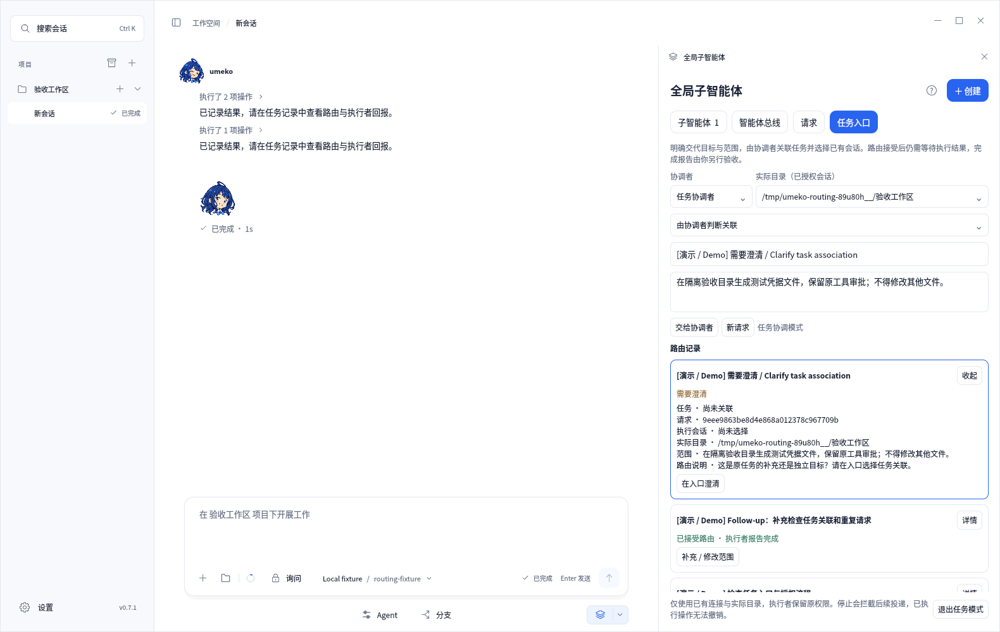
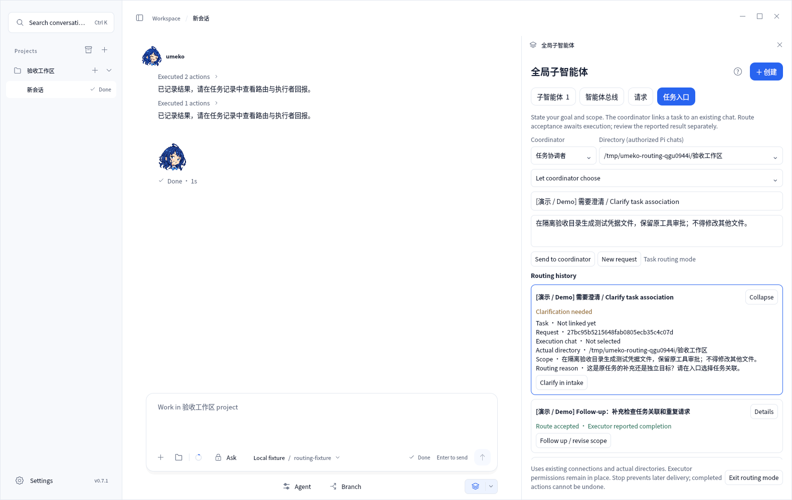
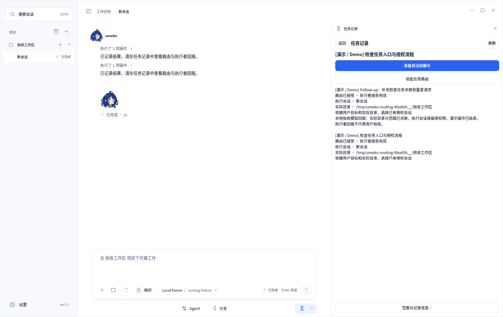
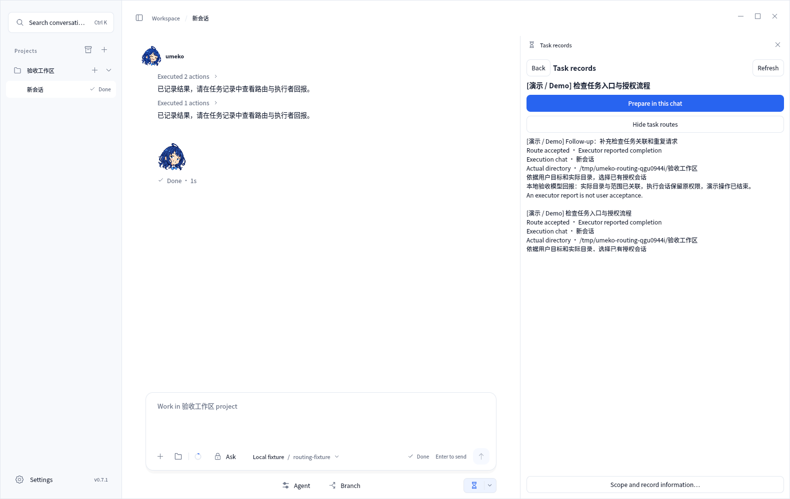

# Task intake and routing: validation for #43

Validated on 2026-11-10 UTC against upstream main `76f68efbf7622f7382e0de4b6946a91ee096987c`. The user explicitly accepted the reviewed implementation before submission. Product source is unchanged from the accepted review package; this submission adds reproducible validation evidence and screenshots.

## Checks run for submission

| Check | Result |
| --- | --- |
| `python prepare_runtime.py` | Passed; Pi coding-1.3.0 projection verified against current bridge and extension sources. |
| `python scripts/build-desktop-plugin-resources.py` | Passed; Widget SDK resources built. |
| `python -m unittest tests.test_task_routing tests.test_task_records tests.test_global_agents tests.test_widget_host tests.test_desktop_plugins` | 127 tests passed. |
| `node --test tests/global-agents.test.mjs tests/umeko-control.test.mjs tests/task-timeline.test.mjs` | 12 tests passed. |
| `python tests/task_routing_ui_smoke.py` | Passed with Chinese UI and isolated demonstration data. |
| `UMEKO_TEST_LANGUAGE=en python tests/task_routing_ui_smoke.py` | Passed with English task-entry UI and isolated bilingual demonstration data. |
| `git diff --check` | Passed. |

Both UI runs use actual Qt/QML windows and native Pi coordinator/executor processes. A deterministic local model fixture exercises real bridge/tool behavior without contacting an external model. The fixture verifies that an executor in ask mode requests the original write approval, no file exists before approval, execution reports retain the same task identity, duplicate submissions do not create duplicate work, continuation reuses taskId, list refresh does not change retry identity, clarification creates no execution, and the shared task Widget shows executor reports separately from user acceptance. The task-records Widget is explicitly enabled in the isolated profile because current main disables it by default.

Unit coverage also includes two-task/two-session result separation, schema 1/2 migration preserving timeline fields, authorization/directory/model/history rechecks, DSH rejection without replacement Pi sessions, cancellation and scope changes, bus/storage failures, restart interruption, and bounded paging. The implementation and constraints are described in [task-routing.md](task-routing.md).

## Actual screenshots

These PNGs are actual Qt offscreen captures from the tested source. They contain isolated, explicitly labelled demonstration data. The parent global-agents Widget retains its existing Chinese labels in the English run; the new task-entry controls and shared task records use English.

Chinese task entry:

English task entry:

Chinese shared task report:

English shared task report:

## Limits

- The deterministic model verifies orchestration and permission boundaries; it is not an evaluation of real online model routing quality.
- Offscreen screenshots do not establish real-display responsiveness. No performance improvement is claimed.
- The UI runs emit the existing engine-destruction warning about six incubating items; it is retained as a limitation, not described as a warning-free run.
- Earlier acceptance also passed the existing global-agents and task-records UI regressions. The latter recorded QML incubation/destruction and teardown QProcess warnings; those historical runs are not represented as fresh submission runs.
- No installer/package verification, upstream merge, release or publication was performed. CI results must be assessed independently after the PR opens.
- Queue scheduling, structured execution attempts and human-action management remain in #44. Executor-reported completion remains distinct from user acceptance. Work is never automatically replayed after restart or timeout.
